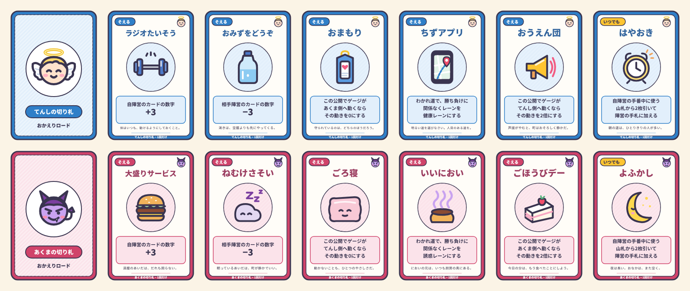

# おかえりロード 拡張ルール

[基本ルール](RULES.md) に慣れてきたら、ここにある拡張ルールを好きなものだけ足して遊べます。どれも単独で足せます。迷ったら、上から順に1つずつ足していくのがおすすめです。

| 拡張ルール | 足すと何が変わるか | 覚えること |
|---|---|---|
| [切り札カード](#切り札カード) | ここぞという場面の一発逆転と、ゲーム前の作戦（どの3枚を選ぶか） | 少し多い |
| [お気に入りスート（+3）](#お気に入りスート3) | 「どのスートを、どのお店まで取っておくか」の悩み | 少ない |
| [歩幅カード](#歩幅カード) | 手番プレイヤーが、止まるマスを狙える | 少ない |
| [ペア出し](#ペア出し) | 同じ数字2枚で大きく勝てる、大勝負マスの切り札 | 少ない |
| [上級ルール：スート効果](#上級ルールスート効果) | 勝ったカードのスートで追加効果 | 多い |

## 計算の順番と手札の上限

拡張ルールを足したときの **計算の順番** は、基本ルールの3段階にそれぞれの加算を差し込みます。

1. **数字**：カードの数字（ペアは合計、1枚で出した A は相手が絵札なら14）→ 妨害なら0、♣ の半減なら半分（切り上げ。番狂わせの A は14の半分で7）→ がんばれ +2・+4 → 切り札の +3／−3（0未満は0）
2. **差**：主役 − 横やり（0未満は0）／大きい方 − 小さい方 → 勝った（通った）カードの K +3、お気に入りスート +3
3. **2倍**：大勝負マス、または切り札「おうえん団」「ごほうびデー」（重なっても2倍まで）→ 切り札「おまもり」「ごろ寝」が使われていれば、その陣営に不利な向きの動きを0にする → ゲージを動かす（−10〜+10）

**手札の上限**：手札が増える拡張（切り札「はやおき／よふかし」、上級ルールの ♥）を使うときは、各陣営の手札は **合計12枚まで**。超えたら、その陣営はすぐに超えた分を選んで、裏向きのまま捨てる。

## 切り札カード

てんし陣営とあくま陣営には、それぞれ専用の **切り札カード** が6枚ずつあります。ゲームの最初に、各陣営はそのうち **3枚を選んで** 持ちます。どれも1ゲームに **1回だけ** 使えます（画像：[assets/cards/](assets/cards/)、一覧：[trump_cards_sheet.png](assets/trump_cards_sheet.png)）。

| てんしの切り札 | あくまの切り札 | 使い方 | 効果 |
|---|---|---|---|
| ラジオたいそう | 大盛りサービス | そえる | 自陣営のカードの数字 **+3** |
| おみずをどうぞ | ねむけさそい | そえる | 相手陣営のカードの数字 **−3**（0未満にはならない） |
| おまもり | ごろ寝 | そえる | この公開でゲージが **相手側へ動くなら、その動きを0** にする |
| ちずアプリ | いいにおい | そえる | わかれ道で、勝ち負けに関係なく **レーンを自陣営の側**（てんし＝健康、あくま＝誘惑）にする（ゲージは通常どおり） |
| おうえん団 | ごほうびデー | そえる | この公開でゲージが **自陣営側へ動くなら、その動きを2倍** にする |
| はやおき | よふかし | いつでも | 自陣営の手番中に公開して使い、山札から **2枚引いて** 陣営の誰かの手札に加える |

- **準備**：各陣営は6枚から3枚を陣営チャットで相談して選び、裏面（`angel_back.png`／`devil_back.png`）を設定したスクリーンパネルとして、自陣営の手札置き場に **非公開** で置く。選ばなかった3枚は使わない。切り札は手札の枚数に数えない。
- **そえる**：カードを出す場面で、数字カードと一緒に勝負エリアに裏向きで置き、「せーの」で一緒に公開する。1回の公開につき1陣営1枚まで。パスして切り札だけ添えてもよい。
- **いつでも**：自陣営の手番中なら、カードを出している途中以外のいつでも使える。
- 使った切り札は、効果が無かった場合も、表のまま **除外** 枠に置く。
- 初めて切り札を使うときは、選ばずに「ラジオたいそう・おみずをどうぞ・おうえん団」（てんし）、「大盛りサービス・ねむけさそい・ごほうびデー」（あくま）を使うと分かりやすい。
- 例：マス14（大勝負）で、てんしが ♥9＋「おうえん団」、あくまが ♠6＋「ごろ寝」を出した → てんしの勝ちで差3、大勝負と「おうえん団」は重なっても2倍までなので6。しかし「ごろ寝」でてんし側への動きは0になり、**ゲージは動かない**。

細かい処理（パスした相手への −3、引き分けのわかれ道での「ちずアプリ」など）は [よくある質問](FAQ.md#切り札カード) にあります。

## お気に入りスート（+3）

- 健康マス・誘惑マスのお店には、それぞれ **お気に入りスート** があります（ボードのマスの右下に表示）。
- 主役のカードが **通った** とき、そのカードがお店のお気に入りスートなら、ゲージの動きに **さらに +3**（主役の陣営側へ）。横やりのスートは関係ありません。呼び込みでも同じです。

| 陣営 | お気に入りスート |
|---|---|
| 😇 健康マス | 5A こうえん ♣／7A ジム ♠／11A やおや ♦／16 こうえん ♥ |
| 😈 誘惑マス | 5B だがしや ♦／7B ラーメン屋 ♠／11B ファストフード ♣／15 ケーキ屋 ♥ |

- 例：16 こうえん（♥）で、てんしが ♥8、あくまの横やりが ♣5 → 8−5＝3、お気に入り +3 で **ゲージ+6**。

## 歩幅カード

- 手番プレイヤーは、ダイスを振る **前に** 宣言すれば、`1d3+1` の代わりに **手札の A〜4 のカード1枚** を表にして出し、その数字（1〜4）だけ進めます。出すのは陣営の誰の手札からでもよく、出したカードは捨て札になります（補充しない）。
- 移動の扱いはダイスと同じです（わかれ道の勝負、呼び込み、補給）。歩幅カードは勝負エリアでの公開ではないので、妨害・がんばれゾーン・番狂わせ・切り札とは関係しません。
- 例：NPCが 5A にいる、てんしの手番。7A（😇 ジム）に止まりたいので、手札の ♣2 を歩幅カードにして2マス進み、**7A** に止まる。

## ペア出し

- **同じ数字のカード2枚** を、1組として同時に出せます（主役・横やり・カード勝負のどれでも）。数字は **2枚の合計** です（7のペアは14 で、K より強い）。2枚は同じ陣営なら別々の人の手札から1枚ずつ出してもかまいません。
- J・Q・K のペアの効果は **1回分だけ**（K のペアなら 26＋3）。お気に入りスートは2枚のどちらかが一致すれば +3。
- わかれ道でペアが勝ったら、出した陣営が2枚のどちらかの色を選んでレーンを決めます。
- 番狂わせは A を **1枚** で出したときだけ。A のペアは合計2です。相手のペアに絵札が入っていれば、1枚で出した A は14になります。

## 上級ルール：スート効果

勝った（通った）カードのスートに応じて、追加効果が起こります（健康マス・誘惑マス・どちらでもマス・呼び込みで適用。わかれ道ではレーン決定にだけ使い、おかえり勝負では起こらない）。

| スート | 追加効果 |
|---|---|
| ♠ スペード | なし |
| ♥ ハート | 出した人が、山札から **1枚** 引く |
| ♦ ダイヤ | 効果の処理後、NPCがさらに1マス進む（進んだ先のマスも処理する） |
| ♣ クラブ | 相手陣営が次に公開する数字カード1枚の数字を **半分（切り上げ）** にする |

- 負けたカード・横やりのカード・妨害で0になったカードのスート効果は起こりません。
- ♣ の半減は、J「妨害」と同じく相手が次に数字カードを公開するまで続きます。妨害と重なったら妨害が優先します。チャットに「あくま陣営に半減中」などと残します。
- 例：あくまが誘惑マスで ♣6 を通した後、てんしが次の健康マスで ♥K を出し、あくまは横やりしなかった → K は 13 の半分で7、大逆転+3 で **ゲージ+10**。

細かい処理（ペアのスート効果、♦Q、呼び込みでの ♦ など）は [よくある質問](FAQ.md#上級ルールスート効果) にあります。
